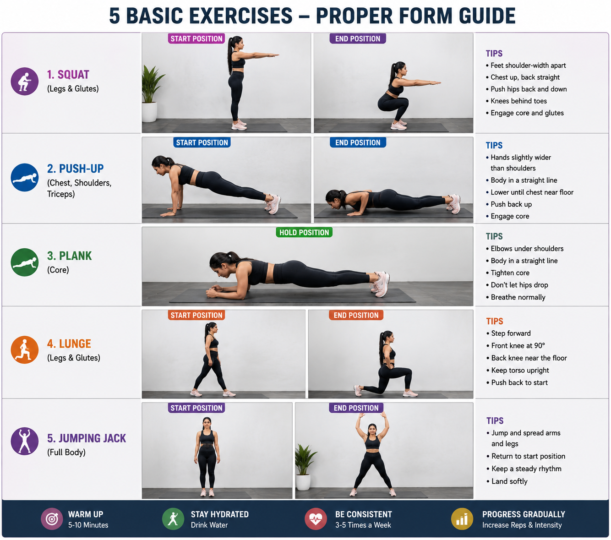

<h1 align="center">GymGenius AI</h1>

<p align="center">
  <b>Your intelligent AI Fitness Coach for real-time form correction, workout tracking, and performance analytics.</b>
</p>

<p align="center">
  
  
  
  
</p>

<hr>

## 📌 Table of Contents
- [✨ Features](#-features)
- [🛠️ Tech Stack](#-tech-stack)
- [📂 Repository Structure](#-repository-structure)
- [⚙️ Requirements](#-requirements)
- [🚀 Installation & Setup](#-installation--setup)
- [📖 Usage Guide](#-usage-guide)
- [🏋️ Supported Exercises](#-supported-exercises-proper-form-guide)
- [🔮 Future Roadmap](#-future-roadmap)

---

## ✨ Features
- **Real-Time Pose Tracking**: Leverages advanced computer vision (MediaPipe) to analyze your form in 3D as you work out.
- **Form Correction & Feedback**: Provides instant, actionable visual feedback to prevent injuries and maximize muscle engagement.
- **Personalized Analytics**: Track your reps, sets, and overall performance over time through an intuitive, data-rich dashboard.
- **Interactive & Modern UI**: A sleek, premium dark-mode aesthetic with neon accents that keeps you motivated and engaged.
- **Secure User Profiles**: Keep your workout data safe with our robust authentication system.

## 🛠️ Tech Stack
- **Framework**: Streamlit, Streamlit-WebRTC
- **AI/ML**: Google MediaPipe, OpenCV
- **Database**: SQLite

## 📂 Repository Structure
```text
GymGenius-AI/
├── auth/
│   └── auth.py               # Authentication and profile management
├── database/
│   └── db.py                 # SQLite database schema and connection helper
├── modules/
│   ├── analytics.py          # Dashboard computations and Plotly chart generators
│   ├── form_analyzer.py      # Core joint angle math and form feedback logic
│   ├── pose_detector.py      # MediaPipe pose landmarker and custom vector drawing
│   ├── rep_counter.py        # Finite State Machine for exercise reps/sets counting
│   └── workout_generator.py  # AI workout plan generator using Gemini (legacy)
├── screenshots/
│   └── basic_exercises.png   # Proper form guideline diagrams
├── app.py                    # Main Streamlit application and WebRTC worker loop
├── README.md                 # Project documentation
└── requirements.txt          # Python environment dependencies
```

## ⚙️ Requirements
- **OS**: Windows, macOS, or Linux
- **Python**: version 3.11+
- **Git**: for cloning the repository
- **pip**: Python package manager
- **Hardware**: A functional webcam/camera is required for live exercise form tracking.

## 🚀 Installation & Setup

1. **Clone the repository**
   ```bash
   git clone https://github.com/shruti29075/GymGenius-AI.git
   cd GymGenius-AI
   ```

2. **Set up a virtual environment (recommended)**
   ```bash
   python -m venv venv
   source venv/bin/activate  # On Windows use: venv\Scripts\activate
   ```

3. **Install dependencies**
   ```bash
   pip install -r requirements.txt
   ```

4. **Run the application**
   ```bash
   streamlit run app.py
   ```

## 📖 Usage Guide
1. Launch the application and open your browser to `http://127.0.0.1:8501`.
2. Create an account or sign in to your dashboard.
3. Allow camera access to enable the 3D skeleton pose tracking.
4. Select your exercise, start your workout, and let GymGenius analyze your form!

## 🏋️ Supported Exercises (Proper Form Guide)

<p align="center">

</p>

GymGenius AI currently tracks and provides real-time feedback on 6 core exercises:

### 1. Squat (Legs & Glutes)
- **Tips**: Feet shoulder-width apart, chest up, and back straight. Push hips back and down. Keep knees behind toes, and engage core and glutes.

### 2. Push-Up (Chest, Shoulders, Triceps)
- **Tips**: Hands slightly wider than shoulders. Keep your body in a straight line. Lower until chest is near the floor, push back up, and engage core.

### 3. Plank (Core)
- **Tips**: Elbows under shoulders, body in a straight line. Tighten your core, don't let hips drop, and breathe normally.

### 4. Lunge (Legs & Glutes)
- **Tips**: Step forward, front knee at 90°. Back knee near the floor. Keep torso upright, and push back to start.

### 5. Jumping Jack (Full Body)
- **Tips**: Jump and spread arms and legs. Return to the start position. Keep a steady rhythm and land softly.

### 6. Bicep Curl (Arms)
- **Tips**: Stand straight with a dumbbell in each hand. Keep elbows close to your torso. Curl the weights while contracting biceps, then lower them back down.

> **💡 General Fitness Guidelines:**
> - 🎯 **Warm Up**: 5-10 Minutes
> - 💧 **Stay Hydrated**: Drink Water
> - ❤️ **Be Consistent**: 3-5 Times a Week
> - 📈 **Progress Gradually**: Increase Reps & Intensity

## 🔮 Future Enhancements
- **Wearable Integration**: Sync with smartwatches (Apple Watch, Garmin, etc.) for heart rate and calorie tracking.
- **Gamification**: Earn badges, climb leaderboards, and maintain daily streaks to stay motivated.
- **Voice Coaching**: Real-time audio cues for pacing and motivation.
- **Dynamic Workout Plans**: AI-generated routines tailored to your specific goals and progress.

---
🔗 **Live Application Link**: [GymGenius AI App](https://gymgenius-ai-ub8ddgrch4bym3cjwhvt9l.streamlit.app/)
